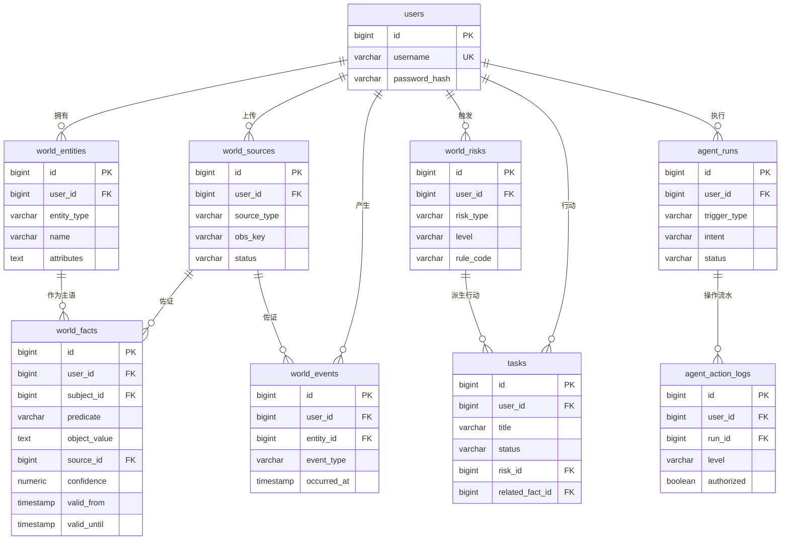

# NEXUS · 数据库设计契约（成员 A 主笔，成员 B Review）

> 状态：阶段一定稿候选。变更须经 PR 合并到 develop 后再改代码（docs/00 整合约定）。
> 技术栈：PostgreSQL 16（华为云 RDS）。本地联调可用 H2 PostgreSQL 兼容模式（`nexus-backend/src/main/resources/db/schema.sql`）。
> 初始化 SQL：`nexus-backend/src/main/resources/db/init-postgres.sql`，与本文件第 4 节同步维护，**本文件为权威**。

---

## 1. 设计原则

1. **数据隔离红线**：除 `users` 外所有业务表必须带 `user_id`，并建立 `(user_id, ...)` 复合索引；查询一律从 JWT 上下文取 `user_id`。
2. 表名/字段名全小写下划线；主键统一 `id`（BIGINT，应用侧雪花 ID，MyBatis-Plus `ASSIGN_ID`）；外键 `<对象>_id`。
3. 每表含 `created_at`、`updated_at`（TIMESTAMP，UTC）；禁止 `SELECT *`，字段清单见第 4 节。
4. 事实表按契约含 `valid_from` / `valid_until` / `confidence`，支撑"事实随时间失效"的世界模型语义。
5. DDL 变更写入迁移文件纳入版本管理（阶段二起引入 Flyway），禁止在云数据库手工改表不落文档。
6. **JSONB→TEXT 变更（2026-11-22，阶段二）**：`world_entities.attributes` 与 `agent_action_logs.payload` 由 JSONB 改为 TEXT 存 JSON 字符串。原因：H2 本地库不支持 JSONB，统一 TEXT 后 H2/PG 双端 DDL 完全一致、应用层用 String 承载；Demo 场景无 JSONB 索引查询需求，代价可接受。B 写事实时不受影响（facts 表无 JSON 字段）。
7. **PR #1 review 对齐变更（2026-11-22，阶段二）**：① `world_facts` 补 `value_type` / `unit` / `normalized_value` / `fact_status` / `evidence` 五列，`world_sources` 补 `sha256` / `page_count` / `uploaded_at` 三列（对齐 B 侧 `extraction-schema.md` 输出，移交清单 P0-2/P0-3）；② `world_risks.level` 枚举 `mid` 改 `medium`（C 端前端已按 medium 实现）；③ `source_id` 类型拍板：保持 BIGINT，B 侧抽取时透传 A 上传接口返回的 `sourceId`，禁止自造 UUID。详见 PR #1 review 意见与 `ResultCode.java` 新增的 90011-90013 抽取校验错误码。
8. **PR #2 review 拍板变更（2026-11-22，阶段二）**：`tasks` 补 `related_fact_id BIGINT REFERENCES world_facts(id)`——B 编排器 create_task payload 携带的 `relatedFactId` 由 A 侧执行器透传落库（原执行器不消费会丢失任务与来源事实的关联），与 `risk_id` 风险溯源设计对称。创建任务时校验该事实存在且属于当前用户，不存在返回 `20102`。

## 2. ER 关系



闭环链路：`world_sources`（上传资料）→ `world_facts`（AI 抽取事实，B 负责）→ `world_risks`（规则引擎）→ `tasks`（行动项）→ `agent_runs` / `agent_action_logs`（授权 Agent 执行）。

## 3. 枚举取值约定（应用层校验，DB 层用 CHECK 约束兜底）

| 表.字段 | 取值 |
| --- | --- |
| world_entities.entity_type | person / asset / event / document / org |
| world_sources.source_type | upload / ocr / manual |
| world_sources.status | pending / parsing / parsed / failed |
| world_facts.status | active / superseded / retracted |
| world_facts.fact_status | confirmed / inferred / unverified（暂定，以 B 主笔的 extraction-schema.md 为准，B 确认后补 CHECK 兜底） |
| world_facts.value_type | string / number / date / boolean |
| world_events.event_type | education / career / asset / health / contract / other |
| world_risks.risk_type | cert_expiry / contract_deadline / asset_concentration / data_staleness / other |
| world_risks.level | low / medium / high（原 mid，2026-11-22 统一为 medium，C 端前端已按 medium 实现） |
| world_risks.status | open / acknowledged / resolved |
| tasks.status | todo / in_progress / done / cancelled |
| tasks.priority | 0(普通) / 1(重要) / 2(紧急) |
| tasks.source_type | manual / risk / agent |
| agent_runs.trigger_type | manual / scheduled / event |
| agent_runs.status | running / succeeded / failed / cancelled |
| agent_action_logs.level | L0(读) / L1(写待确认) / L2(写已授权) |

## 4. 表结构定义与初始化 SQL（PostgreSQL）

```sql
-- ============================================================
-- NEXUS 阶段一 · 9 张核心表初始化 SQL（PostgreSQL 16）
-- 与本文件同步维护；本地 H2 兼容版见 db/schema.sql
-- ============================================================

CREATE TABLE IF NOT EXISTS users (
    id            BIGINT PRIMARY KEY,
    username      VARCHAR(32)  NOT NULL,
    password_hash VARCHAR(100) NOT NULL,
    nickname      VARCHAR(32),
    email         VARCHAR(128),
    status        SMALLINT     NOT NULL DEFAULT 1,          -- 1 正常 / 0 禁用
    created_at    TIMESTAMP    NOT NULL DEFAULT CURRENT_TIMESTAMP,
    updated_at    TIMESTAMP    NOT NULL DEFAULT CURRENT_TIMESTAMP,
    CONSTRAINT uk_users_username UNIQUE (username)
);
COMMENT ON TABLE users IS '用户表：认证主体，个人世界模型数据的根隔离维度';

CREATE TABLE IF NOT EXISTS world_entities (
    id          BIGINT PRIMARY KEY,
    user_id     BIGINT       NOT NULL REFERENCES users(id),
    entity_type VARCHAR(32)  NOT NULL,
    name        VARCHAR(128) NOT NULL,
    attributes  TEXT         NOT NULL DEFAULT '{}',        -- 实体扩展属性（JSON 字符串）
    status      SMALLINT     NOT NULL DEFAULT 1,
    created_at  TIMESTAMP    NOT NULL DEFAULT CURRENT_TIMESTAMP,
    updated_at  TIMESTAMP    NOT NULL DEFAULT CURRENT_TIMESTAMP,
    CONSTRAINT chk_entity_type CHECK (entity_type IN ('person','asset','event','document','org'))
);
CREATE INDEX IF NOT EXISTS idx_we_user_type ON world_entities (user_id, entity_type);
CREATE INDEX IF NOT EXISTS idx_we_user_name ON world_entities (user_id, name);

CREATE TABLE IF NOT EXISTS world_sources (
    id         BIGINT PRIMARY KEY,
    user_id    BIGINT       NOT NULL REFERENCES users(id),
    source_type VARCHAR(16) NOT NULL,
    file_name  VARCHAR(255),
    obs_key    VARCHAR(512),                              -- OBS 对象键（阶段二接 OBS 后填充）
    mime_type  VARCHAR(128),
    file_size  BIGINT,
    sha256     CHAR(64),                                  -- 文件指纹（SHA-256，去重用）
    page_count INT,                                       -- 文档页数（OCR/解析回填）
    uploaded_at TIMESTAMP,                                -- 原始上传时间
    status     VARCHAR(16)  NOT NULL DEFAULT 'pending',
    created_at TIMESTAMP    NOT NULL DEFAULT CURRENT_TIMESTAMP,
    updated_at TIMESTAMP    NOT NULL DEFAULT CURRENT_TIMESTAMP,
    CONSTRAINT chk_source_type CHECK (source_type IN ('upload','ocr','manual')),
    CONSTRAINT chk_source_status CHECK (status IN ('pending','parsing','parsed','failed'))
);
CREATE INDEX IF NOT EXISTS idx_ws_user_status ON world_sources (user_id, status);
CREATE INDEX IF NOT EXISTS idx_ws_user_sha256 ON world_sources (user_id, sha256);

CREATE TABLE IF NOT EXISTS world_facts (
    id           BIGINT PRIMARY KEY,
    user_id      BIGINT       NOT NULL REFERENCES users(id),
    subject_id   BIGINT       NOT NULL REFERENCES world_entities(id),
    predicate    VARCHAR(64)  NOT NULL,                    -- 如 'has_certificate' / 'monthly_income'
    object_value TEXT         NOT NULL,
    value_type   VARCHAR(16)  NOT NULL DEFAULT 'string',  -- 宾值类型：string/number/date/boolean
    unit         VARCHAR(16),                             -- 单位（如 元/万元/%）
    normalized_value TEXT,                                -- 归一化宾值（如金额数字化）
    evidence     TEXT,                                    -- 证据原文摘录（可追溯）
    source_id    BIGINT       REFERENCES world_sources(id),
    confidence   NUMERIC(4,3) NOT NULL DEFAULT 0.500,      -- 0-1，AI 抽取置信度
    valid_from   TIMESTAMP    NOT NULL DEFAULT CURRENT_TIMESTAMP,
    valid_until  TIMESTAMP,                                -- NULL 表示当前有效
    status       VARCHAR(16)  NOT NULL DEFAULT 'active',
    fact_status  VARCHAR(16)  NOT NULL DEFAULT 'confirmed', -- 抽取侧事实状态：confirmed/inferred/unverified（B 已确认）
    created_at   TIMESTAMP    NOT NULL DEFAULT CURRENT_TIMESTAMP,
    updated_at   TIMESTAMP    NOT NULL DEFAULT CURRENT_TIMESTAMP,
    CONSTRAINT chk_fact_status CHECK (status IN ('active','superseded','retracted')),
    -- 命名为 _enum 后缀：chk_fact_status 已被 status 列约束占用（B review 反馈）
    CONSTRAINT chk_fact_status_enum CHECK (fact_status IN ('confirmed','inferred','unverified')),
    CONSTRAINT chk_fact_confidence CHECK (confidence >= 0 AND confidence <= 1)
);
CREATE INDEX IF NOT EXISTS idx_wf_user_subject_pred ON world_facts (user_id, subject_id, predicate);
CREATE INDEX IF NOT EXISTS idx_wf_user_source ON world_facts (user_id, source_id);
-- P1-5 拍板（联调 2026-11-22）：同源同主体同谓词视为同一事实版本，唯一索引挡重抽重复；
-- source_id 为 NULL 的人工录入不参与唯一约束（标准 NULL 语义），重抽写入走服务层链式失效（upsert）
CREATE UNIQUE INDEX IF NOT EXISTS uk_wf_src_fact ON world_facts (user_id, source_id, subject_id, predicate);
COMMENT ON TABLE world_facts IS '个人世界模型事实表：AI 抽取结果的唯一事实存储（成员 B 写入）';

CREATE TABLE IF NOT EXISTS world_events (
    id          BIGINT PRIMARY KEY,
    user_id     BIGINT        NOT NULL REFERENCES users(id),
    entity_id   BIGINT        REFERENCES world_entities(id),
    event_type  VARCHAR(32)   NOT NULL,
    title       VARCHAR(255)  NOT NULL,
    description TEXT,
    occurred_at TIMESTAMP,
    source_id   BIGINT        REFERENCES world_sources(id),
    created_at  TIMESTAMP     NOT NULL DEFAULT CURRENT_TIMESTAMP,
    updated_at  TIMESTAMP     NOT NULL DEFAULT CURRENT_TIMESTAMP,
    CONSTRAINT chk_event_type CHECK (event_type IN ('education','career','asset','health','contract','other'))
);
CREATE INDEX IF NOT EXISTS idx_wv_user_time ON world_events (user_id, occurred_at);
CREATE INDEX IF NOT EXISTS idx_wv_user_entity ON world_events (user_id, entity_id);

CREATE TABLE IF NOT EXISTS world_risks (
    id           BIGINT PRIMARY KEY,
    user_id      BIGINT        NOT NULL REFERENCES users(id),
    risk_type    VARCHAR(32)   NOT NULL,
    level        VARCHAR(8)    NOT NULL,
    title        VARCHAR(255)  NOT NULL,
    description  TEXT,
    entity_id    BIGINT        REFERENCES world_entities(id),
    rule_code    VARCHAR(64)   NOT NULL,                 -- 产生该风险的规则标识，保证风险可追溯
    status       VARCHAR(16)   NOT NULL DEFAULT 'open',
    created_at   TIMESTAMP     NOT NULL DEFAULT CURRENT_TIMESTAMP,
    updated_at   TIMESTAMP     NOT NULL DEFAULT CURRENT_TIMESTAMP,
    CONSTRAINT chk_risk_level CHECK (level IN ('low','medium','high')),
    CONSTRAINT chk_risk_status CHECK (status IN ('open','acknowledged','resolved'))
);
CREATE INDEX IF NOT EXISTS idx_wr_user_status_level ON world_risks (user_id, status, level);

-- P1-6 拍板（联调 2026-11-22）：风险-证据事实关联表，一条风险可对应多条证据事实（DetectedRisk.evidenceFactIds）；
-- 不用数组列：违反范式、无法反查"某事实影响了哪些风险"、无法加外键；
-- 关联行只增不改：事实链式失效（superseded）后关联保留，保证风险结论的历史可追溯
CREATE TABLE IF NOT EXISTS world_risk_facts (
    risk_id BIGINT NOT NULL REFERENCES world_risks(id),
    fact_id BIGINT NOT NULL REFERENCES world_facts(id),
    PRIMARY KEY (risk_id, fact_id)
);
CREATE INDEX IF NOT EXISTS idx_wrf_fact ON world_risk_facts (fact_id);

CREATE TABLE IF NOT EXISTS tasks (
    id          BIGINT PRIMARY KEY,
    user_id     BIGINT        NOT NULL REFERENCES users(id),
    title       VARCHAR(255)  NOT NULL,
    description TEXT,
    status      VARCHAR(16)   NOT NULL DEFAULT 'todo',
    priority    SMALLINT      NOT NULL DEFAULT 0,
    due_date    DATE,
    source_type VARCHAR(16)   NOT NULL DEFAULT 'manual',
    risk_id     BIGINT        REFERENCES world_risks(id),
    related_fact_id BIGINT    REFERENCES world_facts(id),      -- 来源事实溯源（Agent 基于事实派生任务，PR #2 review 拍板新增）
    created_at  TIMESTAMP     NOT NULL DEFAULT CURRENT_TIMESTAMP,
    updated_at  TIMESTAMP     NOT NULL DEFAULT CURRENT_TIMESTAMP,
    CONSTRAINT chk_task_status CHECK (status IN ('todo','in_progress','done','cancelled')),
    CONSTRAINT chk_task_priority CHECK (priority IN (0,1,2)),
    CONSTRAINT chk_task_source CHECK (source_type IN ('manual','risk','agent'))
);
CREATE INDEX IF NOT EXISTS idx_tk_user_status ON tasks (user_id, status);
CREATE INDEX IF NOT EXISTS idx_tk_user_due ON tasks (user_id, due_date);

CREATE TABLE IF NOT EXISTS agent_runs (
    id           BIGINT PRIMARY KEY,
    user_id      BIGINT        NOT NULL REFERENCES users(id),
    trigger_type VARCHAR(16)   NOT NULL,
    intent       VARCHAR(255)  NOT NULL,                  -- 本次执行的用户意图描述
    status       VARCHAR(16)   NOT NULL DEFAULT 'running',
    summary      TEXT,                                    -- 结束后写入执行摘要
    started_at   TIMESTAMP     NOT NULL DEFAULT CURRENT_TIMESTAMP,
    finished_at  TIMESTAMP,
    created_at   TIMESTAMP     NOT NULL DEFAULT CURRENT_TIMESTAMP,
    updated_at   TIMESTAMP     NOT NULL DEFAULT CURRENT_TIMESTAMP,
    CONSTRAINT chk_run_trigger CHECK (trigger_type IN ('manual','scheduled','event')),
    CONSTRAINT chk_run_status CHECK (status IN ('running','succeeded','failed','cancelled'))
);
CREATE INDEX IF NOT EXISTS idx_ar_user_status ON agent_runs (user_id, status);

CREATE TABLE IF NOT EXISTS agent_action_logs (
    id          BIGINT PRIMARY KEY,
    user_id     BIGINT        NOT NULL REFERENCES users(id),
    run_id      BIGINT        NOT NULL REFERENCES agent_runs(id),
    action_type VARCHAR(64)   NOT NULL,                  -- 如 read_fact / create_task / send_notification
    level       VARCHAR(4)    NOT NULL,                  -- L0/L1/L2，L2 必须已获用户授权
    target_type VARCHAR(32),
    target_id   BIGINT,
    payload     TEXT          NOT NULL DEFAULT '{}',      -- 操作载荷（JSON 字符串）
    result      VARCHAR(16)   NOT NULL DEFAULT 'pending',-- pending / success / failure / denied
    authorized  BOOLEAN       NOT NULL DEFAULT FALSE,    -- L2 操作的用户授权记录
    created_at  TIMESTAMP     NOT NULL DEFAULT CURRENT_TIMESTAMP,
    updated_at  TIMESTAMP     NOT NULL DEFAULT CURRENT_TIMESTAMP,
    CONSTRAINT chk_log_level CHECK (level IN ('L0','L1','L2')),
    CONSTRAINT chk_log_result CHECK (result IN ('pending','success','failure','denied'))
);
CREATE INDEX IF NOT EXISTS idx_wal_user_run ON agent_action_logs (user_id, run_id);
CREATE INDEX IF NOT EXISTS idx_wal_user_level ON agent_action_logs (user_id, level);
```

## 5. 约束与索引说明

| 关注点 | 设计 |
| --- | --- |
| 数据隔离 | 所有业务表 `user_id NOT NULL` + `(user_id, ...)` 复合索引；应用层查询一律带 user_id |
| 事实时效 | `valid_from/valid_until` 支持历史事实追溯；新事实覆盖旧事实时旧行置 `superseded` |
| 风险可追溯 | `rule_code` 记录产生风险的规则；模型只做解释不产生风险（规范第 6 节） |
| Agent 审计 | `agent_action_logs.level + authorized` 满足 L2 操作留痕要求 |
| 主键 | 应用层雪花 ID（ASSIGN_ID），避免分布式自增冲突 |
| 时间 | TIMESTAMP UTC；查询按索引字段过滤，禁止全表扫描 |

## 6. B 同学注意事项（Review 重点）

1. 写入 `world_facts` 时必须填 `source_id` 与 `confidence`，不符合 `extraction-schema.md` 校验的输出不得入库。校验失败按 A 侧 `ResultCode` 的 90011（缺 sourceId）/ 90012（Schema 不符）/ 90013（谓词未登记）抛 `BizException`。
2. **`source_id` 必须使用 A 侧上传接口（`POST /api/v1/sources/upload`）响应返回的 `sourceId`（雪花数字字符串）透传写入，禁止自造 UUID**（PR #1 review 阻塞项 1 拍板：保持 BIGINT 体系统一，无需映射表）。
3. 抽取到的新主体先落 `world_entities`（按 `(user_id, entity_type, name)` 判重），拿到 `subject_id` 再写事实。
4. `world_sources.status` 由接入服务（A，阶段二）流转，B 只读。
5. 字段增删需提 PR 修改本文件与 `init-postgres.sql`，禁止代码先行。